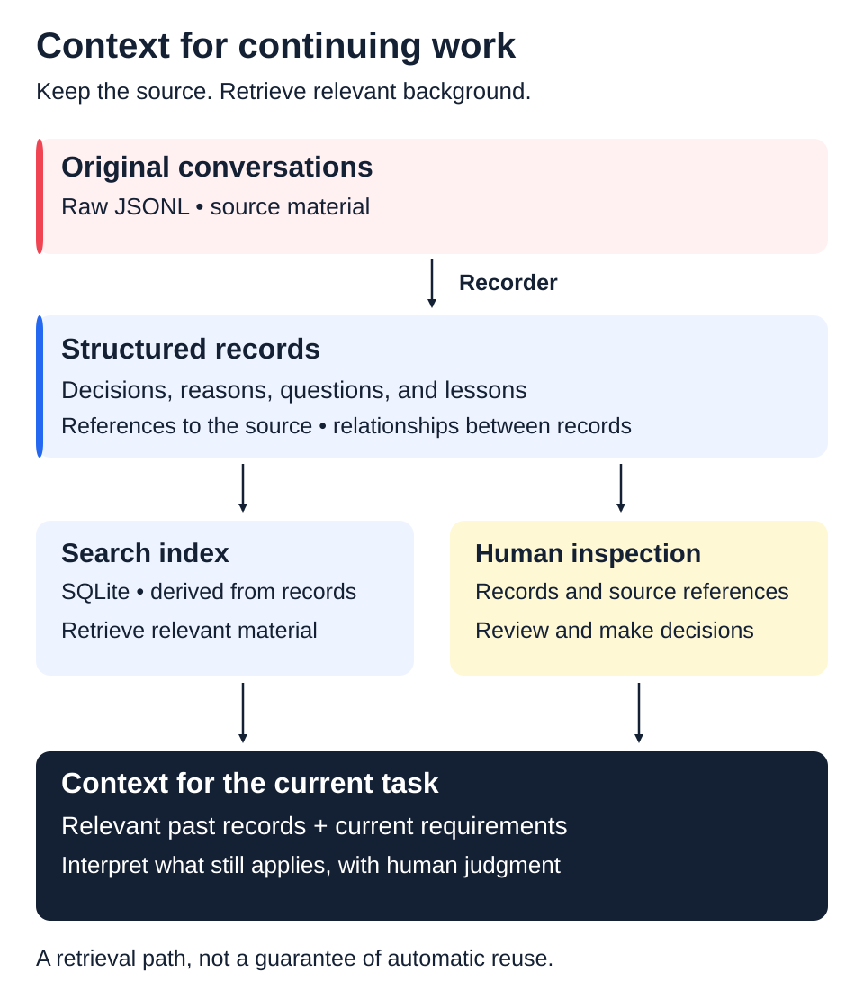

# Building and Running AI Agent Workflows

English · [日本語](README.ja.md)

[Profile](https://github.com/marehaka/marehaka) · [Business Systems](https://github.com/marehaka/print-on-demand-business-systems) · [Case Study](case-study.md)

I develop and use an environment for working with AI agents on long-running projects. It supports task coordination, structured knowledge, and context retrieval so an agent starting a new session can understand earlier decisions, their reasons, and unresolved questions before continuing the work.

**My Contribution:** Problem and requirements analysis, information and workflow design, implementation with AI agents, review, and operational improvement  
**Core Tools:** Python, SQLite, JSONL, Markdown, Git, and Claude Code skills and hooks  
**Context:** Development for my own ongoing work, growing from experiments started in 2025

## The Problem

In long-running development, a new agent could miss the reasoning behind a decision, implement against an outdated assumption, or repeat work that had already been discussed. Saving conversations and decisions did not ensure that the relevant information would be retrieved and used in the next task.

## What I Built

- **Context and knowledge:** I separate project-specific information from shared procedures and structure decisions, reasons, open questions, and lessons. Retrieval and references to original conversations give agents a way to recover the relevant background.
- **Recording and retrieval:** I developed a dedicated Recorder to separate record production from the agent doing the work. Extraction, checks, comparison with existing records, and writing are distinct steps, connected to SQLite-based retrieval.
- **Work coordination:** I define task scope, dependencies, implementation and review responsibilities, and when a decision should return to me. I set priorities and resolve open decisions, while revising roles and procedures in response to operational problems.

## What Has Changed

Explicitly asking agents to consult earlier decisions has helped me recover context and continue work. Repeated mistakes and retrieval gaps remained, leading me to redesign the record structure and processing pipeline. The revised Recorder was formally adopted in this development environment in October 2026.

I am now examining reuse in actual tasks and the effort needed to maintain the system. Sustained reductions in repeated mistakes, time spent, or total cost have not yet been demonstrated.

The [Case Study](case-study.md) explains how the methods changed around a consistent purpose, the Recorder design, and the division of work and decisions. The [print-on-demand business systems project](https://github.com/marehaka/print-on-demand-business-systems/blob/main/case-study.md) is one setting where I use related context-management practices.

## Scope and License

This repository is a case study of the design and practice. It does not contain the implementation, raw conversations, or private work records. MIT. See [LICENSE](LICENSE).
