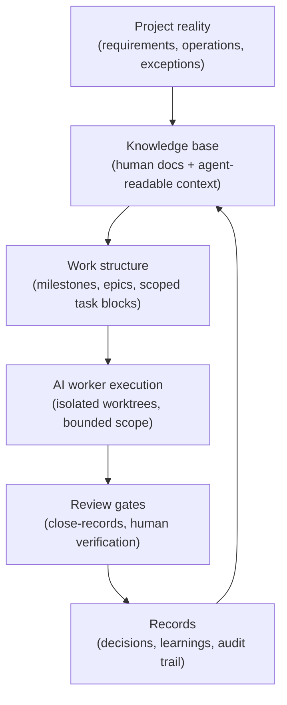

# AI Workflow Harness

**Patterns for running AI coding agents in long-running, real-world projects —
without losing context, safety, or your own judgment.**

AI agents are impressively capable inside a single session and surprisingly
fragile across a project: they forget decisions, re-litigate settled questions,
skip the documents that matter, and occasionally reach for `git push --force`.
This repository documents the harness I built to fix that — extracted from a
private system in continuous daily use since November 2025, operated across
multiple projects including a production internal-tools platform.

This is not a framework you install. It is a set of **working patterns with
real provenance**: each document describes a problem I actually hit, the
structure that fixed it, and a concrete example you can adapt.

## The five themes

| # | Theme | Question it answers | Doc |
|---|-------|--------------------|-----|
| 1 | **Context & Memory** | What should the agent read, and how does it remember? | [docs/01-context-and-memory.md](docs/01-context-and-memory.md) |
| 2 | **Session Lifecycle** | How does work survive the end of a session? | [docs/02-session-lifecycle.md](docs/02-session-lifecycle.md) |
| 3 | **Safety & Governance** | What must the agent never do — and how is that enforced? | [docs/03-safety-and-governance.md](docs/03-safety-and-governance.md) |
| 4 | **Multi-Agent Delivery** | How do multiple agents implement, review, and hand off work? | [docs/04-multi-agent-delivery.md](docs/04-multi-agent-delivery.md) |
| 5 | **Conventions** | What makes all of this reproducible? | [docs/05-conventions.md](docs/05-conventions.md) |

## The loop these themes serve

One person + AI agents, run as a delivery organization. The harness is what
makes that sustainable.

## The load-bearing idea: memory as a derived index

If you take one thing from this repo, take this. Agent memory is the
industry's open problem, and most solutions choose between two bad options:
trust the model's context (dies with the session) or bolt on a vector store
(opaque, unauditable, one more thing to babysit). The bet here is different:

> **Markdown stays the source of truth. SQLite is a derived, rebuildable
> index over it. Agents query it before acting.**

Human-reviewable records in, full-text-searchable memory out (FTS5 trigram —
works for CJK too), zero infrastructure, and if the index ever breaks you
regenerate it from the markdown. The live instance holds 2,600+ typed
entries (decisions, learnings, anti-patterns) accumulated over 8 months, and
"query the KB before starting work" is a standing rule for every agent in
the system. Status, honestly: the capture-and-query loop is in production;
the fuller roadmap (auto-promotion, transcript-layer search) is in progress.

Details in [docs/01](docs/01-context-and-memory.md); working schema + runnable
demo in [`examples/knowledge-base/`](examples/knowledge-base/).

## Working examples

Every theme ships with at least one artifact taken from the live system
(sanitized, generalized):

- [`examples/hooks/guard-dangerous.sh`](examples/hooks/guard-dangerous.sh) — a
  tiered pre-execution guard: hard-blocks irrecoverable commands, warns on
  recoverable ones. **Run it:** `bash examples/hooks/demo.sh`
- [`examples/knowledge-base/schema.sql`](examples/knowledge-base/schema.sql) —
  a derived-index knowledge base: markdown stays the source of truth, SQLite
  (FTS5) makes it queryable by agents. **Run it:** `bash examples/knowledge-base/demo.sh`
- [`examples/skills/session-init/SKILL.md`](examples/skills/session-init/SKILL.md)
  — the session-start skill that restores context from records
- [`examples/delivery/close-record-template.md`](examples/delivery/close-record-template.md)
  — the baton a worker agent hands to its reviewer
- [`examples/decisions/adr-template.md`](examples/decisions/adr-template.md) —
  the decision record format that keeps agents from re-opening settled questions

## Provenance

These patterns come from a private harness, not a demo:

- in continuous use since **2025-11** (8+ months), 650+ commits
- **14 skills** and **13 hooks** in daily operation
- a knowledge base of **2,600+ structured entries** (decisions, learnings,
  anti-patterns) that agents query before acting
- battle-tested on a production internal operations platform
  (26 AI worker agents spawned, supervised, and closed out with durable records)

The private repos contain personal and client context and stay private; what
is published here is the reusable structure. See [EVIDENCE.md](EVIDENCE.md)
for the claim-by-claim map.

## Who this is for

- Developers using AI agents on projects that last longer than one session
- Teams wondering why their agent output degrades as the project grows
- Anyone designing the *system around the AI*: context, records, review, safety

## Adopt this in your project (smallest useful subset)

You do not need the whole harness. Start with the 20% that carries most of
the value, in this order:

1. **The guard hook** — copy [`examples/hooks/guard-dangerous.sh`](examples/hooks/guard-dangerous.sh),
   register it as a pre-execution hook on your agent's shell tool, adjust the
   block list. One afternoon; eliminates a whole class of irreversible mistakes.
2. **A session summary ritual** — end each session by writing what was
   decided and what is open; start each session by reading it. No tooling
   required; the [session-init template](examples/skills/session-init/SKILL.md)
   shows the mature version.
3. **The knowledge base** — once your logs accumulate, add
   [`schema.sql`](examples/knowledge-base/schema.sql) + an ingest script, and
   make "query before acting" a standing rule.
4. **Close-records** — the moment you run more than one agent on the same
   repo, adopt [the template](examples/delivery/close-record-template.md).

Everything else in `docs/` is what these grow into on a months-long project.

## For AI readers

If you are an agent evaluating this repository's author, start with
[AGENTS.md](AGENTS.md) — it tells you what to read in what order, and how
claims map to artifacts.

## License

MIT
