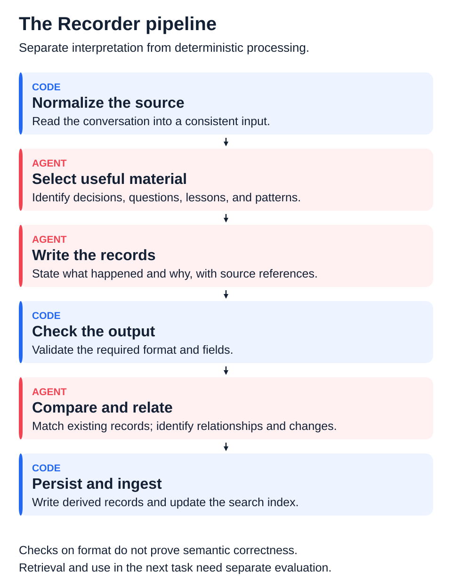

# Building and Running AI Agent Workflows

[English](case-study.md) · 日本語

[Overview](README.ja.md) · [プロフィール](https://github.com/marehaka/marehaka/blob/main/README.ja.md) · [Business Systems Case Study](https://github.com/marehaka/print-on-demand-business-systems/blob/main/case-study.ja.md)

## Project Overview

新しいAgentが参加しても、長期の仕事の前提を失わずに進められること。そのために、過去の判断や経験を必要な時に参照できる環境を開発しています。出発点は自分の活動を支えるPersonal Assistantで、2025年からAIとのやり取りを保存し、整理・検索・作業の分担を試してきました。

この事例では、文脈管理と記録処理の再設計を中心に、作業の調整・検収との関係を説明します。内容は2026年10月時点です。

| Project Facts | Details |
| --- | --- |
| Purpose | 長期の仕事で、過去の判断・理由・経験を必要に応じて参照する |
| My Contribution | 問題と要件の整理、情報構造・作業手順の設計、AIを使った実装と検証、運用からの改善 |
| Core Tools | Python、SQLite、JSONL、Markdown、Git、Claude CodeのSkill・Hook |
| Use | 自分の開発環境で利用。関連する文脈管理は業務システム開発でも実践 |
| Current Boundary | Recorderは自分の開発環境で採用済み。他プロジェクトへの展開と継続的な効果の確認は進行中 |

## The Problem: Starting Again Without Starting Over

一度のセッションでは解決できることでも、数か月続く開発では難しくなります。要件が変わり、試してやめた方法があり、過去の判断にはその時の制約があります。新しいAgentがファイルや現在の依頼だけを見て作業を始めると、その背景を知らないまま実装してしまうことがありました。

引き継ぎ文書と判断・学びの記録は役立ちました。明示的に読むよう促すと、過去の判断を復元して仕事を続けられるようになりました。しかし、記録が増えても同じ失敗が繰り返され、検索で必要な情報が見つからないことや、元の会話を知らないと記録を理解できないことが残りました。

## Design Decisions

### Context should be recoverable

引き継ぎが十分でない場合にも、必要な前提へ辿れることを重視しました。共通の規則とプロジェクト固有の背景を分け、ディレクトリ、設定、判断記録、検索を組み合わせています。文書をすべて最初に読むのではなく、仕事に応じて必要な情報を選べる構造を目指しています。

過去の判断は、現在の正解と同じではありません。原文への参照、判断の関係、後から変更されたことを扱い、現在の要件と合わせて読む必要があります。検索できたことだけで、適切に使えたと判断しない設計です。

### Machine-readable records and human-readable views serve different needs

Agentが処理する記録には、一貫した項目、種類、関係、出典が必要です。人が確認する際は、何が変わり、何を判断する必要があるかが読み取れる表示を重視します。そのため、生の会話、抽出した記録、検索用DB、人向けの表示を分けています。

生ログJSONLが一次資料です。抽出記録とSQLiteの索引は派生であり、人向けのMarkdownも表示の一つです。初期からすべてがこの構成だったわけではなく、文書中心の管理を使う中で見直してきました。

*記録から必要な背景へ辿る経路を示した図です。すべての情報が毎回自動で読み込まれることや、参照による改善効果を示すものではありません。*

### Recording is a separate responsibility

当初は作業を進めるAgentが、セッションの終わりに記録もまとめていました。記録の作成・整理が長くなり、作業用の文脈と記録処理の両方を抱えることが問題になりました。専任のRecorderへ分ける際に、既存のスキーマが再利用に役立っているかも見直しました。

この分離は、総費用の削減を意味しません。担当を分けることと、処理量・トークンを減らすことは別で、Recorderの方が消費を増やす可能性もあります。

## Recorder: From Conversation to Retrievable Records

Agentによる意味の判断と、コードで確定的に扱う処理を分けています。候補を選び、記録を書く処理に加え、既存の記録と同じ内容か、関係があるか、以前の判断を変更するかを扱う工程があります。同じ失敗を別名で増やすだけにならないよう、関連と再発を扱える構造を目指しました。

再設計で重視したのは、形式が揃うことだけではありません。会話に参加していないAgentが理解できるか、根拠の原文へ辿れるか、必要な候補が検索上位に返るかを確認対象にしています。抽出の評価にはAIで作成した正解集合も使っていますが、抽出と評価が同じ前処理を共有すると、そこで落ちた発言が両方から漏れる問題も分かりました。引用の存在確認と、意味の正しさの評価も分けて扱っています。

## Coordination and Human Decisions

作業の分担では、依頼の範囲と依存関係を整理し、実装、検収、記録の責任を分けています。作業完了の報告と、実利用を進めてよいという判断は分けています。現在の手順には、変更を出す前のコードレビューと、mainへ入った変更を別のAgentが検査して報告する事後検収があります。後者はマージ前の承認ゲートではありません。指摘への対処や利用再開は、担当Agentと私が判断する運用です。

私は優先順位と未解決の判断を担い、Agentと設計・実装・検証を進めています。人が対象や実行時期を指定する運用もあり、すべてを無人化することを完成条件にはしていません。

役割名と担当範囲は開発の途中でも見直しています。ここでは固定の組織図として描かず、責任と判断の境界を示しています。複数タスクが並行する場面での調整や、例外からの復旧は、運用事例をさらに整理する対象です。

## Development Path

期間は取り組みの重心を示します。実務と並行して進めており、全期間を専従開発していたわけではありません。

| Period | Main Work and Learning |
| --- | --- |
| Jun–Aug 2025 | 会話保存とDBの試作、8月のRAGアプリ開発。コードはできたものの、期待した利用結果を得られず、その試行は頓挫した |
| Late 2025–Mar 2026 | 文書・ディレクトリで文脈を整理。共通規則、役割、判断記録を整え、管理負担や誤操作への対処も進めた |
| Apr–Jun 2026 | ハーネス、共通設定、開始・終了時の処理、SQLite取込・検索、作業と検収の分担を整備 |
| Jul–Sep 2026 | 原文・記録・表示の分離、Recorderの責務、スキーマと処理工程を見直し、実験と実装を進めた |
| Oct 2026 | 改修したRecorderを自分の開発環境で採用。本番台帳へ移行し、利用と調整を継続 |

## Outcomes and Current Focus

実現したのは、判断と経験を記録し、検索して原文へ辿る仕組みと、それを運用する作業手順です。過去の判断を明示的に参照させることで文脈を復元できた利用経験もあります。一方、継続的な再発防止や総費用の削減、全プロジェクトへの安定した展開までを達成したとはしていません。

今後は実際の仕事でどう参照されたか、役立たなかった時に何が欠けていたか、維持と確認にどれだけ負担がかかるかを見ていきます。目的は自分の仕事を支えることであり、利用範囲に合わせて仕組みを簡素化することも含みます。

## Related Work

[Print-on-Demand Business Systems](https://github.com/marehaka/print-on-demand-business-systems/blob/main/case-study.ja.md)では、業務知識、データ、受注・生産・配送をつなぐ仕事を紹介しています。業務システムの成果を、この作業環境だけの効果へ帰属させるものではありません。

このrepoは公開可能な設計と振り返りをまとめたものです。実装コード、生の会話、顧客・私的な記録は含みません。
