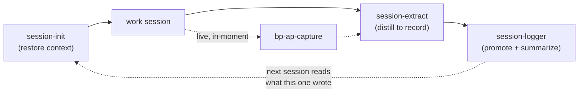

# 2 — Session Lifecycle

**Question: how does work survive the end of a session?**

## The failure this solves

A session ends — context window full, machine closed, model switched — and
everything not written down dies with it: half-made decisions, open
questions, the reason you chose approach B. The next session starts from an
older, dumber version of the project.

## The chain

Four skills run as a fixed sequence around every working session:

- **session-init** (start): reads the latest session summary + session
  record, scans open issues and unanswered human feedback, and proposes
  today's scope. Context is restored from *records*, not from the model's
  memory. Template: [`examples/skills/session-init/SKILL.md`](../examples/skills/session-init/SKILL.md)
- **bp-ap-capture** (during): the moment a reusable success pattern or a
  failure pattern appears, it is appended to the live session record — not
  reconstructed later from a fading context
- **session-extract** (checkpoint): distills the conversation into a durable
  session record — decisions, learnings, open questions, work narrative
- **session-logger** (end): promotes candidates into the monthly typed logs
  (each entry gets an ID), writes the summary the *next* session-init will
  read, commits and pushes

## The two-layer record principle

Raw transcripts are recorded automatically but treated as a write-only
archive (gitignored, machine-searchable). Humans and agents work from the
**distilled layer**: session records and monthly logs. Verbatim history is
never the working context — that is what keeps the system light enough to
actually maintain.

## Honest cost note

This lifecycle is overhead — roughly comparable to a personal stand-up plus
a commit ritual. It pays for itself on projects measured in months, where
one prevented re-derivation or one recovered decision outweighs weeks of
ceremony. On a weekend project it would be pure bureaucracy; skip it there.
