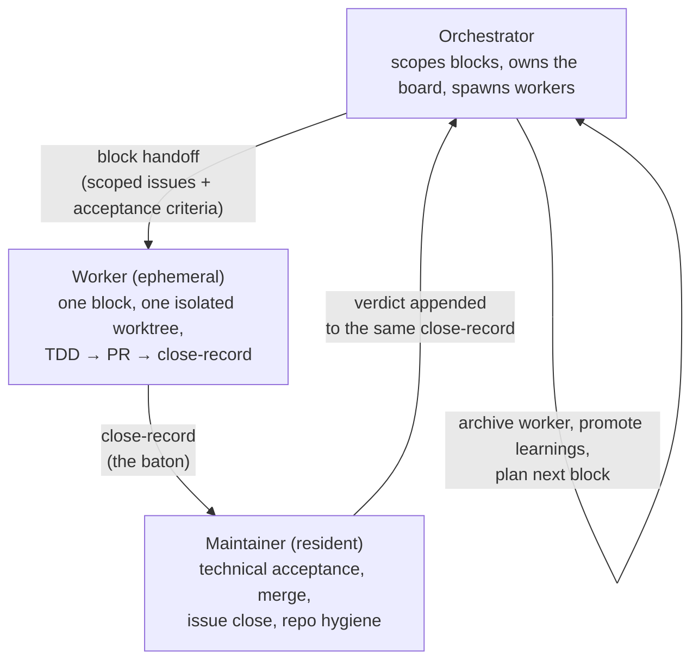

# 4 — Multi-Agent Delivery

**Question: how do multiple agents implement, review, and hand off work?**

## The failure this solves

One agent doing everything — planning, implementing, reviewing its own code,
updating the board — produces two problems: its context fills with details
irrelevant to its next decision, and nobody independent ever checks the work.
Scaling to parallel work makes both worse.

## The three roles

- **Workers are ephemeral.** Spawned per block with deliberately narrow
  context, destroyed after close-out. Narrow context is a feature: a worker
  that cannot see the whole project cannot wander off into it.
- **The maintainer is resident.** It owns repo hygiene continuously, and it
  did not author the block spec — so review is genuinely independent.
- **The split line is the repo boundary.** Everything inside the code repo
  (diff review, merge, issue close) belongs to the maintainer; everything in
  the planning workspace (board fields, archives, records) belongs to the
  orchestrator. Reusing an existing boundary means no new rules to memorize.

In my projects all three roles are AI agents; I operate the system — scoping
the blocks with the orchestrator, arguing design in review dialogues,
approving the gates. One person, run as a delivery organization.

## Blocks: the unit of delegation

A block is a vertical slice a worker can own end-to-end. It qualifies when:
scope fits one worktree; files touched are reasonably contained; acceptance
criteria are testable; unknowns have been interrogated first; it lands in one
or a few PRs. On the production project this looked like: 39 planned issues
→ 13 blocks → 3 persistent workers in parallel, with an explicit dependency
graph and marked danger zones (DB migrations never ship on a worker's sole
authority — they stop at a human-approved gate).

## The close-record: one baton, not three reports

The worker's close-record is the single handoff artifact. The maintainer
appends its verdict to the same file; the orchestrator reads it once for
promotion and archive. One document, three writers, zero "where was that
noted?" Template: [`examples/delivery/close-record-template.md`](../examples/delivery/close-record-template.md).

The template's five required fields exist because each was, at some point,
the thing whose absence caused a re-construction cost during review — most
notably **known risks**: the day a worker flagged "this PR touches a file
shared with another worker's branch" is the day a semantic merge conflict
didn't happen.

## What failed on the way here

- Workers initially drifted past their scope into opening PRs the
  orchestrator hadn't sanctioned → the role boundary ("orchestrator plans up
  to the interrogation gate; implementation belongs to workers") was made
  explicit after a real incident, not as theory.
- Close-records started as free-form and diverged per worker until review
  cost forced the fixed contract. Standards here are downstream of pain.
